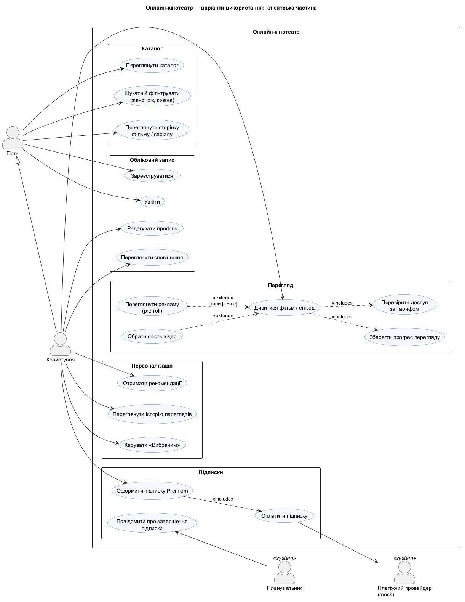
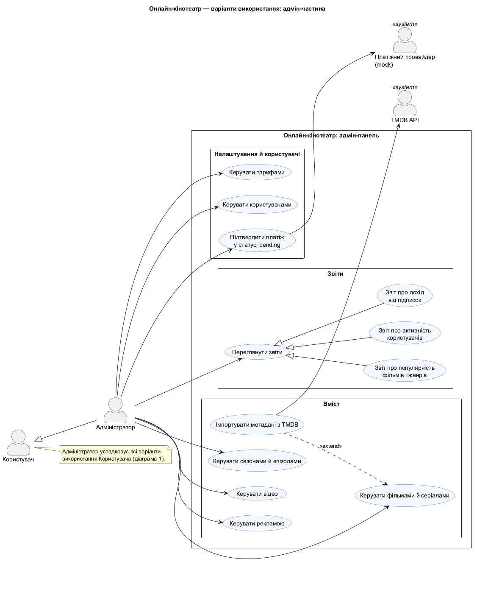

# Діаграма варіантів використання

Джерело: [`uml/use-case.puml`](uml/use-case.puml). Щоб діаграма лишалася читабельною, її розділено на дві частини.

### Клієнтська частина

### Адмін-частина

## Актори

| Актор | Опис |
|---|---|
| Гість | Неавторизований відвідувач. Переглядає каталог, шукає фільми, може зареєструватися або увійти. |
| Користувач | Зареєстрований глядач із тарифом Free або Premium. Успадковує всі можливості гостя. |
| Адміністратор | Користувач із роллю `admin`. Успадковує можливості користувача й керує вмістом, тарифами та користувачами, переглядає звіти. |
| TMDB API | Зовнішній сервіс, з якого імпортуються метадані фільмів і серіалів. |
| Платіжний провайдер (mock) | Імітація платіжної системи. Повертає результат оплати: `success`, `pending` або `failed`. |
| Планувальник | Системний процес, який періодично перевіряє підписки, що завершуються. |

Між акторами є узагальнення: **Адміністратор → Користувач → Гість**. Кожна наступна роль має всі права попередньої.

## Варіанти використання

### Каталог
- **Переглянути каталог.** Список фільмів і серіалів із постером, назвою, жанром і рейтингом.
- **Шукати й фільтрувати.** Пошук за назвою, фільтри за жанром, роком, країною та типом (фільм або серіал), сортування.
- **Переглянути сторінку фільму / серіалу.** Опис, рейтинг, жанри, країни, для серіалу ще сезони й епізоди.

### Обліковий запис
- **Зареєструватися / Увійти.** Створення облікового запису та вхід. Після входу видається JWT-токен.
- **Редагувати профіль.** Ім'я та аватар.
- **Переглянути сповіщення.** Наприклад, про успішну оплату або про те, що підписка скоро завершиться.

### Перегляд
- **Дивитися фільм / епізод.** Відтворення відео у форматі HLS.
  - `<<include>>` **Перевірити доступ за тарифом.** Система визначає, які якості дозволені тарифом користувача (Free: до 720p, Premium: до 1080p).
  - `<<include>>` **Зберегти прогрес перегляду.** Позиція перегляду зберігається, щоб можна було продовжити з того ж місця. Ці дані використовують рекомендації та звіти.
  - `<<extend>>` **Обрати якість відео.** Користувач вручну обирає якість серед дозволених.
  - `<<extend>>` **Переглянути рекламу (pre-roll).** Умова розширення: користувач має тариф Free.

### Персоналізація
- **Керувати «Вибраним».** Додати тайтл до списку «Вибране» або прибрати з нього.
- **Отримати рекомендації.** Добірка тайтлів на основі жанрів переглянутих фільмів і загальної популярності.
- **Переглянути історію переглядів.** Список переглянутого з прогресом.

### Підписки
- **Оформити підписку Premium.**
  - `<<include>>` **Оплатити підписку.** Взаємодія з платіжним провайдером. Після успішної оплати підписка активується автоматично.
- **Повідомити про завершення підписки.** Ініціює Планувальник: користувач отримує сповіщення, коли до кінця підписки лишається кілька днів.

### Адміністрування
- **Керувати фільмами й серіалами.** Створення, редагування та видалення тайтлів.
  - `<<extend>>` **Імпортувати метадані з TMDB.** Автоматичне заповнення картки тайтлу з TMDB API.
- **Керувати сезонами й епізодами**, **відео**, **тарифами**, **рекламою**, **користувачами.** CRUD основних сутностей і налаштувань системи.
- **Підтвердити платіж у статусі pending.** Адміністратор вручну завершує платіж, що завис у статусі `pending`, імітуючи відповідь банку.
- **Переглянути звіти.** Загальний варіант використання з трьома спеціалізаціями:
  - звіт про популярність фільмів і жанрів;
  - звіт про активність користувачів;
  - звіт про дохід від підписок.
